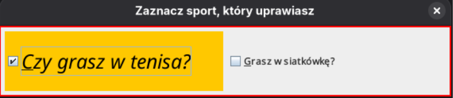
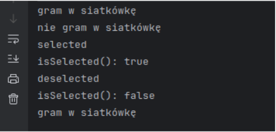
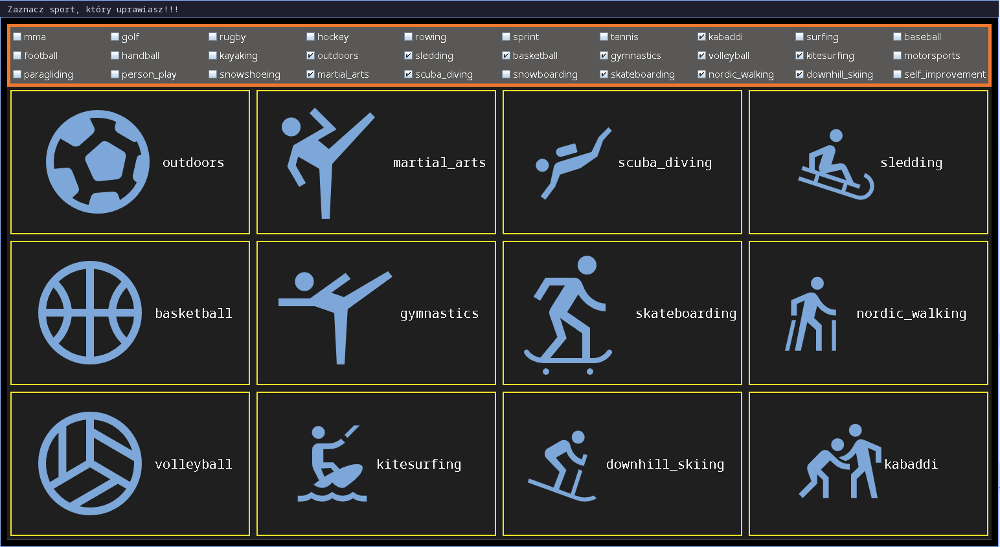
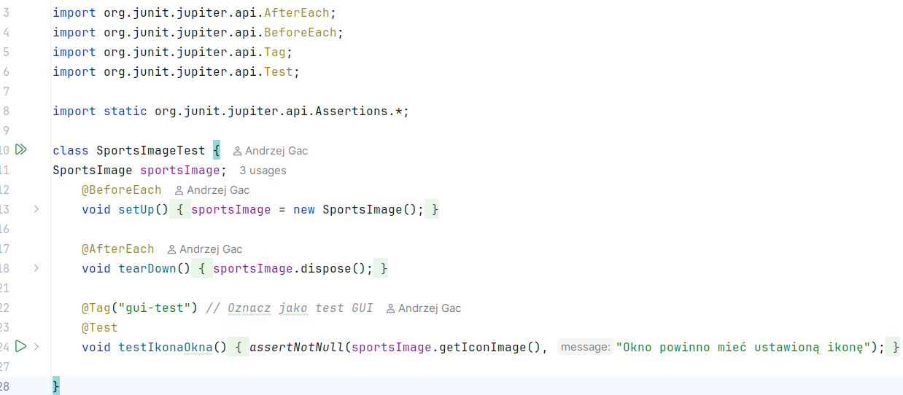

# Ćwiczenia 12 -- praca z JFrame, JComboBox, ItemListener

Na koniec zajęć prześlij pliki źródłowe i z danymi, wynikami do zasobu w
teams.

1. Utwórz nowy projekt w katalogu na dysku C:

1. Dodaj package cwiczenia12.

1. Dodaj podstawowe metody

   ```java 
   JCheckBox checkboxTenis = new JCheckBox("Czy grasz w tenisa?");
   ```

1. Ikony pobierz z katalogu Obrazy z teams: plik sport.zip.

1. Pierwsza postać aplikacji do testów:

   

1. Ustaw: czcionkę, kolory, obramowanie, akcje zaznaczenia z Alt z klawiatury,

1. Dodaj do obsługi ItemListenera:  

   ```java
   checkboxTenis.addItemListener(new ItemListener() {
            @Override
            public void itemStateChanged(ItemEvent e) {
   ```

1. Wynik w terminalu:

   

1. Druga postać aplikacji do testów:

   

1. Przygotuj panel dla checkbox i umieść go na północ.

1. Przygotuj panel na obrazki w układzie gridLayout(3,3) i umieść panel w centrum.

1. Zaznaczenie danego checkboxa dodaje obrazek do panelu, odznaczenie powoduje zniknięcie.

1. Zastosuj obramowania dla paneli oraz obrazków.

1. Popraw wygląd aplikacji poprzez:

   - dobór czcionki, klasa Font,
   - wyświetlenie całych napisów na przyciskach,
   - dodaj ikonę aplikacji,
   - dodaj kolory.

1. Zmodyfikuj klasę tak, aby implementowała ItemListener.

   ```java
   /**
   * Klasa SportImageAppIconSport
   * <p>
   * Aplikacja Swing wyświetlająca listę sportów do wyboru za pomocą JCheckBox.
   * Po zaznaczeniu sportu, jego ikona i nazwa pojawiają się w panelu obrazów.
   */
   public class SportImageAppIconSport extends JFrame implements ItemListener {
   ```

1. Dodaj klasę z testem sprawdzającą czy dodałeś/aś ikonę aplikacji.

   

1. Koniec.🔚
