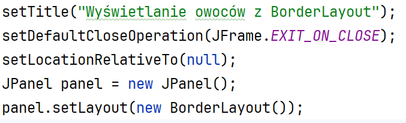
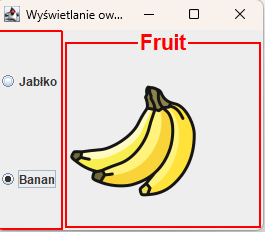
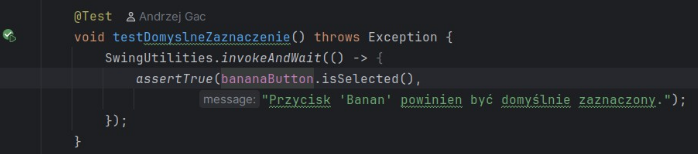
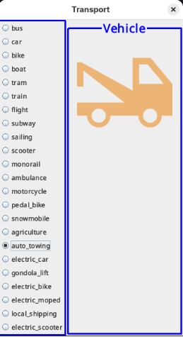

# Ćwiczenia 13 -- praca z JFrame, JRadioButton, ActionListener

Na koniec zajęć prześlij pliki źródłowe i z danymi, wynikami do zasobu w
teams.

1. Utwórz nowy projekt w katalogu na dysku C:

1. Dodaj w konstruktorze

   

1. Ikony pobierz z katalogu Obrazy lub z teams: plik fruits.zip.

1. Postać aplikacji do testów:

   

1. Przygotuj panel w układzie Grid z jedną kolumną dla jradiobox i
    umieść go na lewo( zachód).

1. Etykietę na obrazek umieść w centrum.

1. Zaznaczenie danego jradiobuttona wyświetla dany obrazek.

1. Zastosuj obramowania dla panelu oraz etykiety.

1. Popraw wygląd aplikacji poprzez:

   - dobór czcionki, klasa Font,
   - dodaj ikonę aplikacji,
   - dodaj kolory.

1. Dodaj test dla domyślnego zaznaczenia:

   

1. Zmodyfikuj klasę tak, aby implementowała ActionListener.

1. Przygotuj nową klasę (drugi plik), w której zaprogramujesz obsługę większej ilości jradiobuttonów, nazwy
zaczytaj z plików

   

1. Dodaj obramowania jak wcześniej.

1. Przygotuj nową klasę (trzeci plik), w której zaprogramujesz obsługę jak wcześniej, ale nazwy i/lub ścieżki
można przechować w HashMap lub ArrayList.

1. Dodaj obramowania jak wcześniej.

1. KONIEC.
