# Ćwiczenia 14 -- rysowanie

---

_Na koniec zajęć prześlij pliki źródłowe i z danymi, wynikami do zasobu w
teams._  

---

1. Utwórz nowy projekt w katalogu na dysku C:
2. Dodaj klasę MyDraw, która rozszerza JFrame.
3. Dodaj 3 klasy o nazwach LeftPanel, MiddlePanel i RightPanel , które dziedziczą po JPanel.

4. Zastosuj BoxLayout:

  
 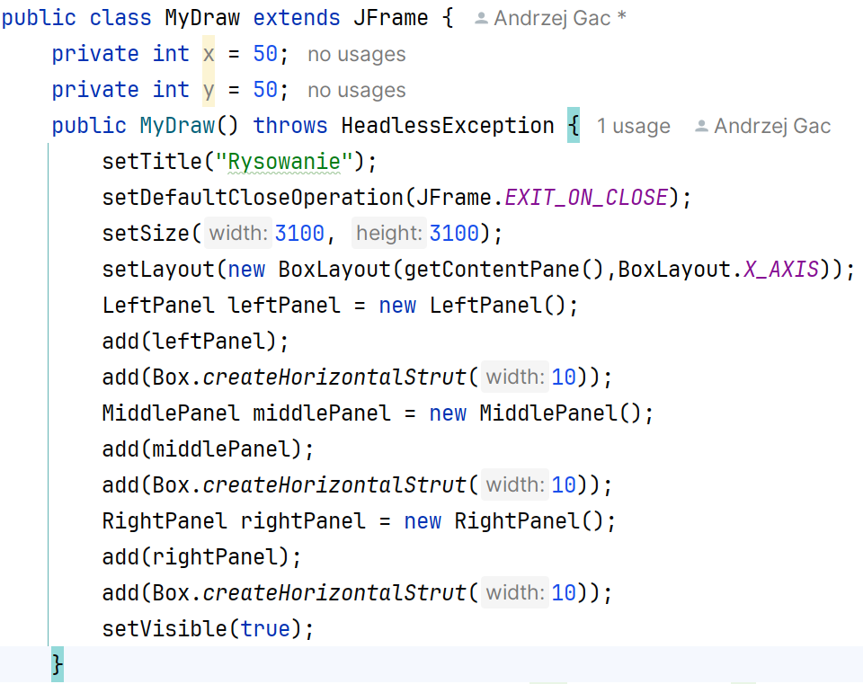 

1. W klasach LeftPanel, MiddlePanel i RightPanel dodaj konstruktory, a w nich delikatne kolory tła, oraz preferowany rozmiar.

  
 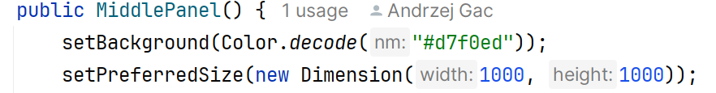 

1. W klasach LeftPanel, MiddlePanel i RightPanel nadpisz metodę paintComponent ( Ctrl+o ).

  
 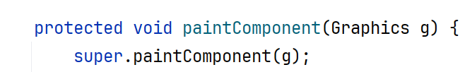 

1. Dodaj antyaliasing.
2. Przetestuj proste przykłady z wykładu, dobierz odpowiednie kolory:

* Rysowanie tekstu

  
 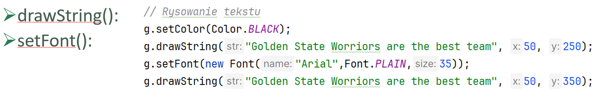 

* Rysowanie koła i okręgu

  
 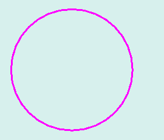 

  
 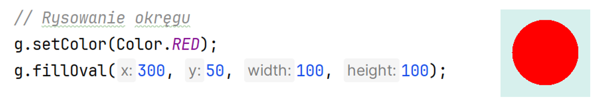 

* Rysowanie linii, dodaj również linię
 pionową i pod kątem 45 stopni.

 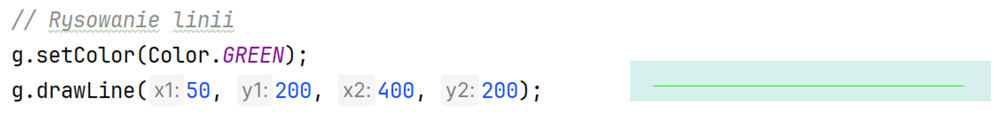

* Rysowanie prostokąta
 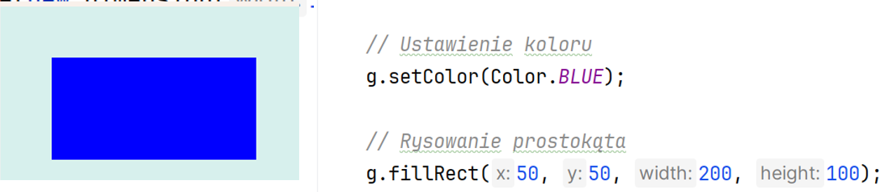

* Inne: rysowanie: łuku, wycinka
    koła
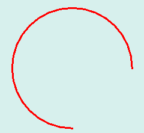 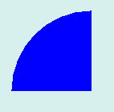

1. Dodaj trapez, metody moveTo, lineTo dla Path2D. Dodaj obrys.
 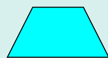

2. Dodaj prostokąt z gradientem liniowym, na dwa kolory i trzy:  
 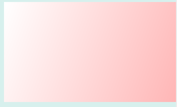
 
 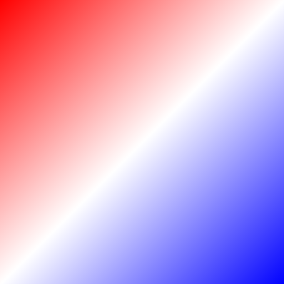

3. Dodaj koło z gradientem radialnym na dwa i trzy kolory:

4. Dodaj koło z gradientem radialnym na dwa i trzy kolory:

   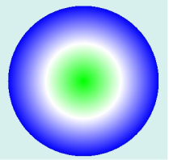
5. Odrysuj wybrane warzywo z pliku.

   

6. Dodaj wycinek koła:
 
7. Dodaj sześciokąt z obrysem:  
 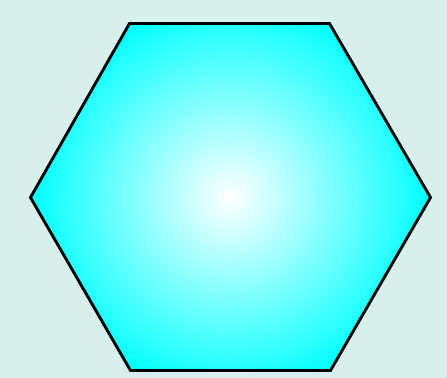
8. Dodaj elipsę z cieniem:  
 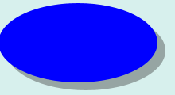
9. Dodaj gwiazdę (drawPolygon):  
 
10. Dodaj prostokąt z zaokrąglonymi narożnikami:  
 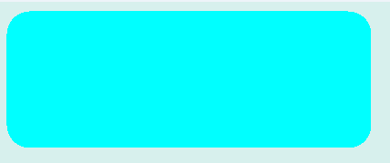
11. Narysuj krzywą Beziera:  
 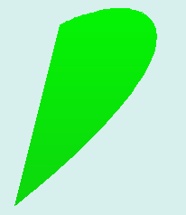
12. Narysuj krzywą kwadratową:  
 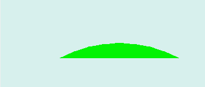
13. Zapisz wybrane grafiki do pliku png, np.:  
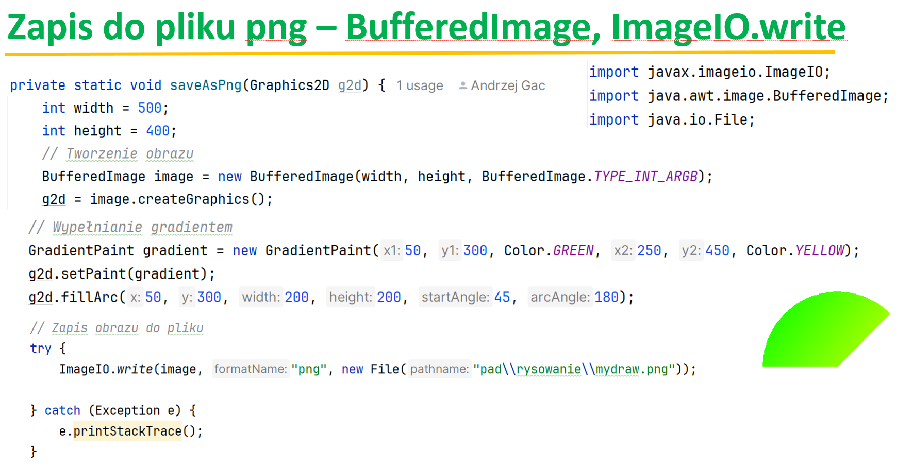

14. KONIEC.  
