# Ćwiczenia 6 -- klasy, dziedziczenie, polimorfizm, enkapsulacja

Na koniec zajęć prześlij pliki źródłowe z danymi, wynikami do zasobu w
teams.

1. Utwórz nowy projekt.
1. Nie importuj żadnych bibliotek, zostaną zaimportowane automatycznie.
1. Stwórz package o nazwie komputery, prawy klawisz myszy na src

   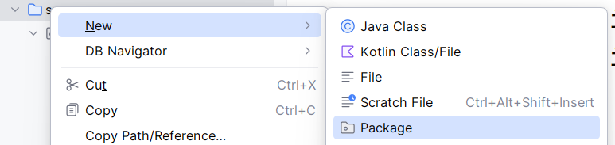

1. Tworzymy klasę komputer o polach/atrybutach: producent, model i rok
    produkcji.

   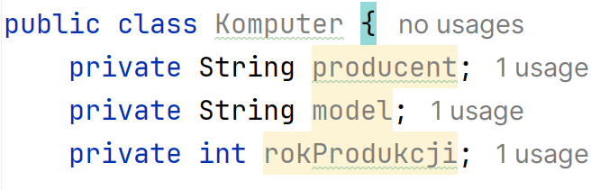

   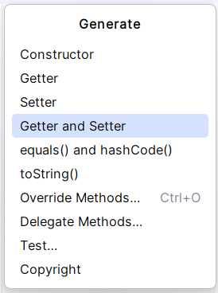

1. Utwórz konstruktor dla tych pól.

   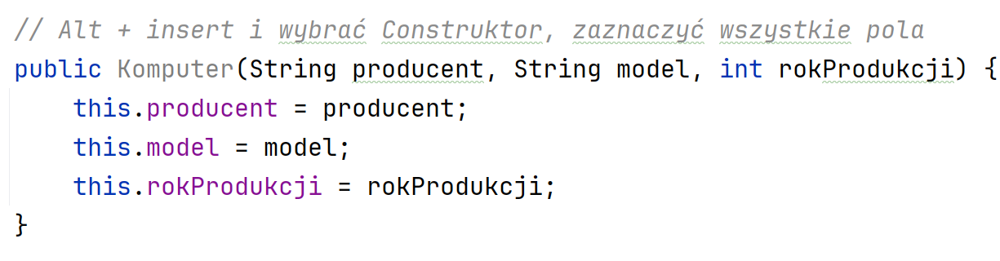

1. Utwórz obiekt klasy Komputer

   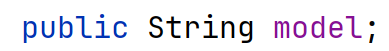
   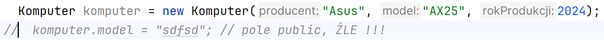

1. Utwórz gettery i setery dla wszystkich
    pól.

   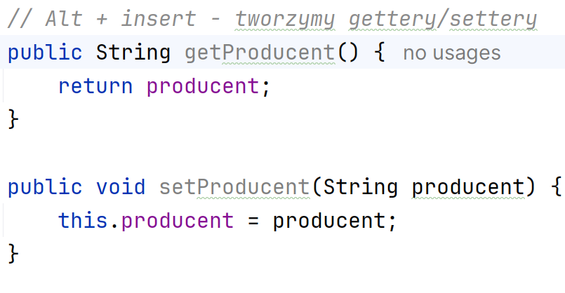

1. Testujemy gettery i setery dla wszystkich pól, ale najpierw utwórz
    konstruktor bezargumentowy:

   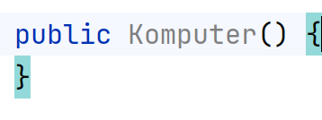

1. Stwórz obiekt i nadaj/odczytaj wartości:

   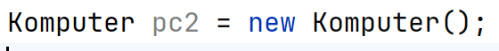

   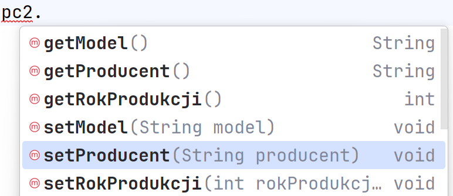

1. Widok po teście ( o ile dodasz wersję java 25):

   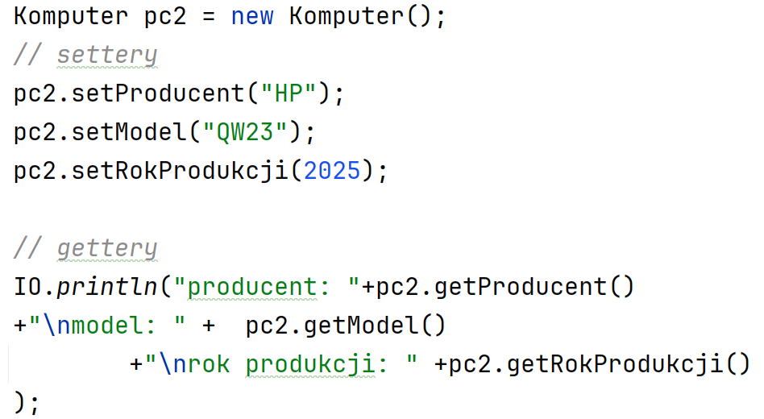

1. Utwórz klasę potomną o nazwie Laptop, na package komputery prawy
    klawisz myszy i New:

   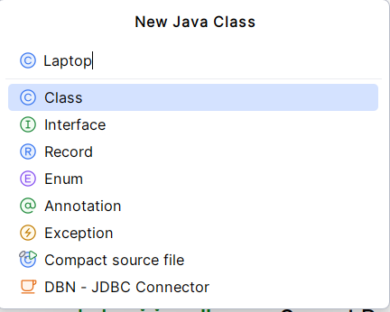

   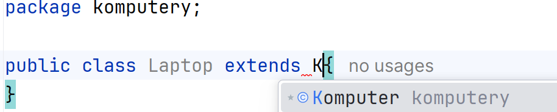

1. Dodaj trzy nowe pola:

   ```java
   public class Laptop extends Komputer{
    private double waga;
    private int iloscPortowUSB;
    private float czasPracyNaBaterii; // w godzinach
   ```

1. Dodaj konstruktor z klasy nadrzędnej z uwzględnieniem nowych pól:

   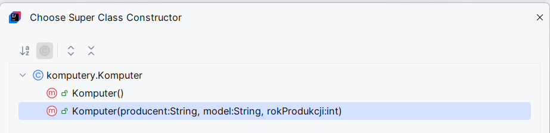

   W drugim kroku:

   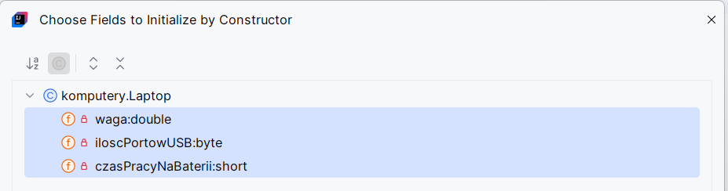

   ```java
   public Laptop(String producent, String model, int rokProdukcji, double waga, int iloscPortowUSB, float czasPracyNaBaterii) {
        super(producent, model, rokProdukcji);
        this.waga = waga;
        this.iloscPortowUSB = iloscPortowUSB;
        this.czasPracyNaBaterii = czasPracyNaBaterii;
    }
   ```

1. Dodaj metodę toString w klasie Komputer oraz w Laptop:

   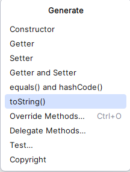

   W klasie Laptop ( dopisz super.toString()):

   ```java
   @Override
    public String toString() {
        // Zamiast wywoływać super.toString(), tworzymy kompletną reprezentację,
        // która zawiera pola z klasy bazowej Komputer.
        return "Laptop{" +
                "producent='" + getProducent() + '\'' +
                ", model='" + getModel() + '\'' +
                ", rokProdukcji=" + getRokProdukcji() +
                ", waga=" + waga +
                ", iloscPortowUSB=" + iloscPortowUSB +
                ", czasPracyNaBaterii=" + czasPracyNaBaterii +
                '}';
    }
   ```

1. Utwórz obiekt klasy Laptop i nadaj/odczytaj wartości:

   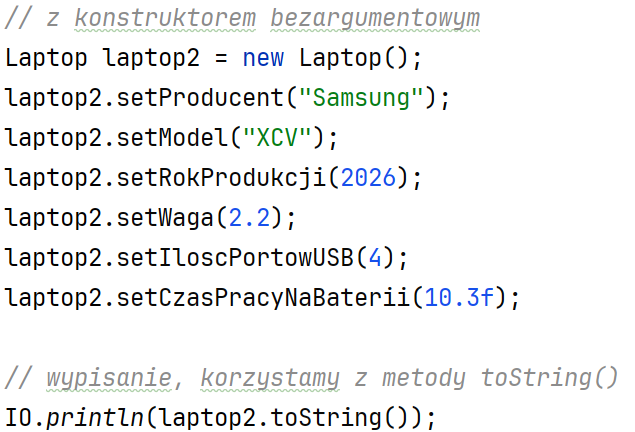

1. Utwórz metodę włącz w klasie nadrzędnej Komputer:

   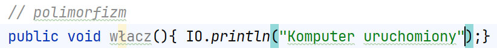

1. Nadpisz metodę włącz() w klasie Laptop:

   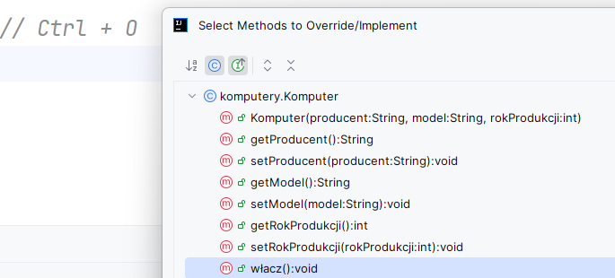

   Dla klasy Laptop:

   ```java
   // Ctrl + O
    @Override
    public void włacz() {
       // super.włacz();
        IO.println("Laptop się uruchamia ...");
    }
   ```

1. Przetestuj polimorfizm.

   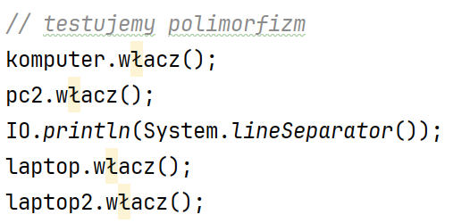

   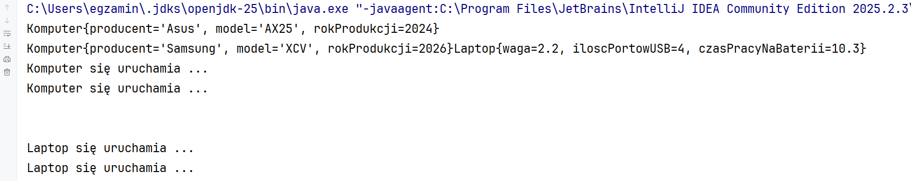

1. Utwórz klasę potomną o nazwie Smartfon.

   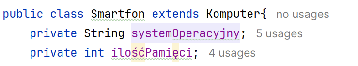

1. Dodaj wszystko tak jak dla klasy Laptop.

   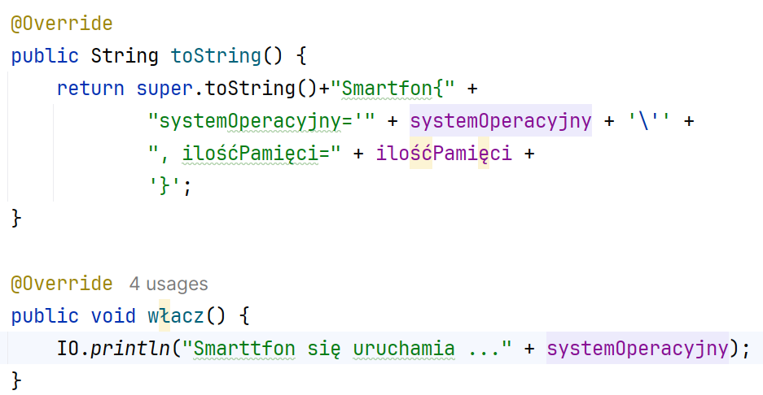

1. Wywołanie w Main:

   ```java
    // Smartfon
        Komputer smartfon = new Smartfon("Google", "Pixel 10 Pro", 2025, "Android", 8);
        Smartfon smartfon2 = new Smartfon("Apple", "17 Pro", 2025, "Apple IOS", 16);
       smartfon2.setProducent("Apple");
       smartfon2.setModel("17 Pro");
       smartfon2.setRokProdukcji(2025);
       smartfon2.setSystemOperacyjny("ios 17");
       smartfon2.setIlośćPamięci(16);

    IO.println(smartfon.toString());
    IO.println(smartfon2.toString());
    smartfon.włacz();
    smartfon2.włacz();
   ```

1. Wykonaj testy.

   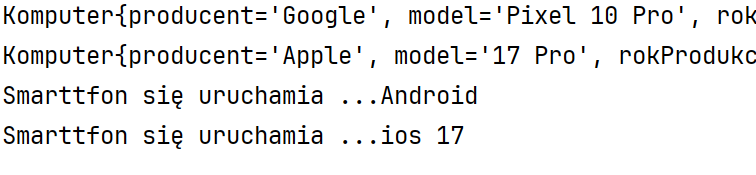

1. Zaimplementuj metody equals(), clone() i hashCode() w klasie Komputer oraz dodaj metodę copy().

   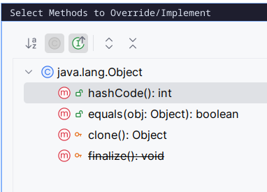

   ```java
   @Override
    public int hashCode() {
        return Objects.hash(producent, model, rokProdukcji);
    }

    @Override
    public boolean equals(Object obj) {
        if (this == obj) return true; // ten sam obiekt w pamięci
        if (!(obj instanceof Komputer)) return false; // inny typ
        Komputer komputer = (Komputer) obj;
        return rokProdukcji == komputer.rokProdukcji &&
                Objects.equals(producent, komputer.producent) &&
                Objects.equals(model, komputer.model);
    }

   public Komputer copy(String producent, String model, int rokProdukcji) {
        return new Komputer(
                producent != null ? producent : this.producent,
                model != null ? model : this.model,
                rokProdukcji >= 0 ? rokProdukcji : this.rokProdukcji
        );
    }
   ```

1. Utwórz klasę TestKomputerów do sprawdzenia tych metod.

   ```java
   package komputery;

   import java.util.HashSet;
   import java.util.Set;

    public class TestKomputerow {

        public static void main(String[] args) {

            // Tworzymy kilka obiektów
            Komputer k1 = new Komputer("Dell", "XPS", 2022);
            Komputer k2 = new Komputer("Dell", "XPS", 2022);
            Komputer k3 = new Komputer("HP", "Pavilion", 2021);

            // Wyświetlamy
            IO.println("k1: " + k1);
            IO.println("k2: " + k2);
            IO.println("k3: " + k3);
            IO.println();

            // --- equals() ---
            IO.println("k1.equals(k2): " + k1.equals(k2)); // true
            IO.println("k1.equals(k3): " + k1.equals(k3)); // false
            IO.println();

            // --- hashCode() ---
            IO.println("hashCode k1: " + k1.hashCode());
            IO.println("hashCode k2: " + k2.hashCode());
            IO.println("hashCode k3: " + k3.hashCode());
            IO.println();

            // --- HashSet ---
            Set<Komputer> set = new HashSet<>();
            set.add(k1);
            set.add(k2); // nie zostanie dodany, bo equals == true
            set.add(k3);

            IO.println("Zawartość HashSet:");
            for (Komputer k : set) {
                IO.println(k);
            }
            IO.println();

            // --- copy() ---
            Komputer k4 = k1.copy(null, "Latitude", -1); // zmieniamy tylko model
            IO.println("k4 (kopiowany z k1, zmieniony model): " + k4);
            IO.println("k1.equals(k4): " + k1.equals(k4)); // false

            Smartfon smartfon = new Smartfon("Samsung", "Galaxy S21", 2022, "Android", 128);
                    IO.println(smartfon);
        }
    }

   ```

1. Dodaj nowy package i utwórz klasę nadrzędną oraz dwie potomne według
    własnego pomysłu, testuj analogicznie jak wcześniej.

1. Dodatkowe zadania:
   - Dodaj klasę Desktop oraz potomną dla niej GamingDesktop,
   - Zaimplementuj metody equals() i hashCode()

   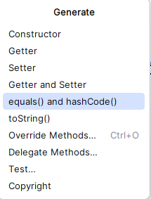

   - dodaj test

   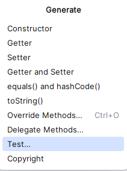

   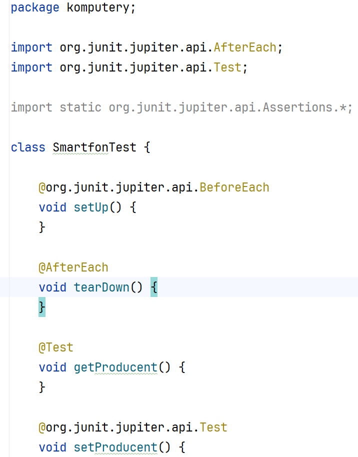

1. KONIEC.
